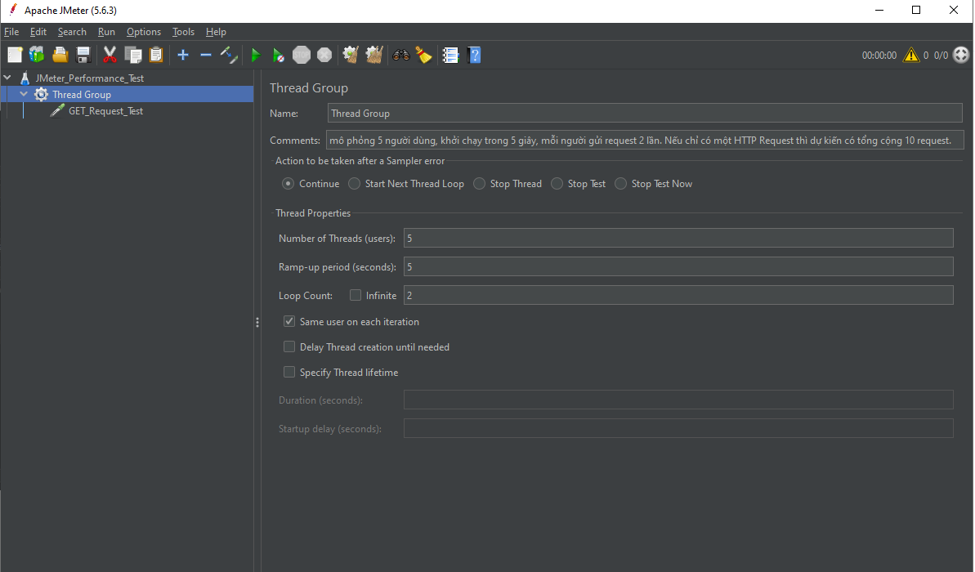
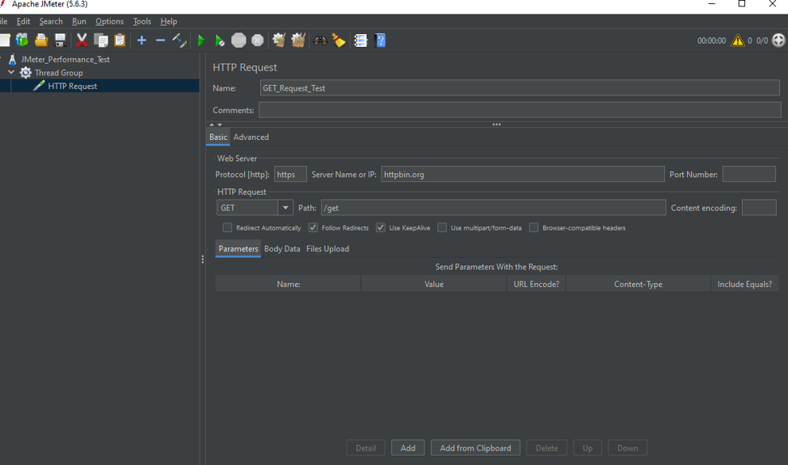
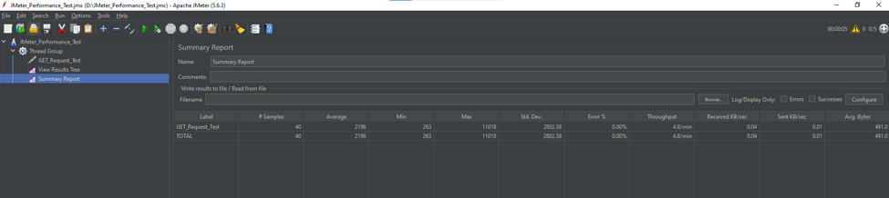
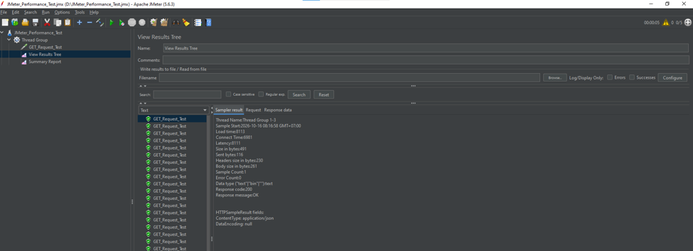

# Báo cáo thực hành kiểm thử hiệu năng bằng Apache JMeter

## 1. Thông tin sinh viên

- **Họ và tên:** [Điền họ tên]
- **Mã sinh viên:** [Điền mã sinh viên]
- **Lớp:** [Điền lớp]
- **Môn học:** Kiểm thử phần mềm

## 2. Mục tiêu

- Tìm hiểu công cụ kiểm thử hiệu năng Apache JMeter.
- Biết cách tạo và cấu hình Test Plan.
- Thực hiện kiểm thử HTTP Request.
- Theo dõi thời gian phản hồi, số lượng request và tỷ lệ lỗi.
- Phân tích kết quả kiểm thử và viết báo cáo.

## 3. Công cụ và môi trường

- **Công cụ:** Apache JMeter 5.6.3
- **Hệ điều hành:** Windows
- **Giao thức:** HTTPS
- **Phương thức kiểm thử:** HTTP GET
- **Đối tượng kiểm thử:** `https://httpbin.org/get`

## 4. Các bước thực hiện

### 4.1. Tạo Test Plan và cấu hình Thread Group

Tạo Test Plan có tên `JMeter_Performance_Test`, sau đó thêm Thread Group để cấu hình số người dùng ảo, thời gian khởi chạy và số vòng lặp.

### 4.2. Cấu hình HTTP Request

Thêm HTTP Request với các thông số:

| Thuộc tính | Giá trị |
|---|---|
| Protocol | https |
| Server Name or IP | httpbin.org |
| Method | GET |
| Path | /get |

### 4.3. Thực hiện kiểm thử

Chạy Test Plan bằng nút Start trên giao diện JMeter. Sử dụng Summary Report để tổng hợp kết quả kiểm thử.

### 4.4. Kiểm tra kết quả phản hồi

Sử dụng View Results Tree để kiểm tra trạng thái request, thời gian phản hồi và dữ liệu trả về từ máy chủ.

## 5. Kết quả kiểm thử

Kết quả ghi nhận từ lần chạy thử nghiệm:

| Chỉ số | Kết quả |
|---|---:|
| Tổng số request | 40 |
| Thời gian phản hồi trung bình | 2196 ms |
| Thời gian phản hồi nhỏ nhất | 263 ms |
| Thời gian phản hồi lớn nhất | 11018 ms |
| Độ lệch chuẩn | 2802,58 ms |
| Tỷ lệ lỗi | 0% |
| Throughput | 4,8 request/phút |

## 6. Nhận xét và đánh giá

Trong lần chạy thử nghiệm, JMeter ghi nhận 40 request và tỷ lệ lỗi bằng 0%.

Thời gian phản hồi trung bình là 2196 ms, trong khi thời gian phản hồi lớn nhất là 11018 ms. Kết quả cho thấy thời gian xử lý giữa các request có sự chênh lệch.

Tuy nhiên, kết quả trên chỉ phản ánh một lần kiểm thử với cấu hình hiện tại. Chưa thể kết luận về khả năng chịu tải tối đa của hệ thống nếu chưa thực hiện thêm các bài kiểm thử với mức tải khác nhau.

## 7. Kết luận

Qua bài thực hành, em đã làm quen với giao diện Apache JMeter, biết cách cấu hình HTTP Request, chạy kiểm thử và sử dụng Summary Report cùng View Results Tree để theo dõi kết quả.

Bài thực hành giúp em hiểu rõ hơn về các chỉ số cơ bản trong kiểm thử hiệu năng phần mềm.

## 8. Tài liệu tham khảo

1. Apache JMeter - Getting Started: https://jmeter.apache.org/usermanual/get-started.html
2. Apache JMeter - Building a Web Test Plan: https://jmeter.apache.org/usermanual/build-web-test-plan.html
3. Apache JMeter - Component Reference: https://jmeter.apache.org/usermanual/component_reference.html
